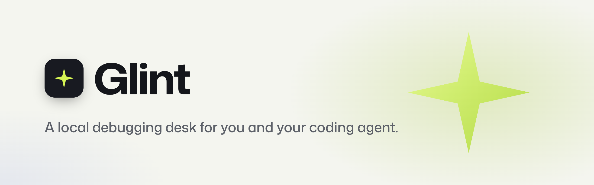

<p align="center">
  <picture>
    <source media="(prefers-color-scheme: dark)" srcset="docs/assets/banner-dark.png">
    
  </picture>
</p>

<p align="center">
  <a href="https://github.com/sodx/glint-releases/releases/latest"></a>
  
  
  
</p>

<p align="center">
  <a href="https://github.com/sodx/glint-releases/releases/latest"><b>Download for Mac</b></a> ·
  <a href="docs/INSTALL.md">Install guide</a> ·
  <a href="#documentation">Docs</a> ·
  <a href="docs/agents.md">Coding agents</a>
</p>

Glint shows what your programs did: values, logs, SQL, exceptions, timings and LLM calls from PHP,
Python, Node and the browser, live in one window. Your coding agent reads the same events over MCP,
so it sees the error and the line instead of guessing. Everything stays on your machine.

<picture>
  <source media="(prefers-color-scheme: dark)" srcset="docs/assets/run-dark.png">
  
</picture>

## Quick start

Download the [latest release](https://github.com/sodx/glint-releases/releases/latest), drag Glint
into Applications, open it and click **Set up this Mac**. Then send something from any program,
with no import:

```bash
echo '<?php glint(["hello" => "from PHP"]);' > /tmp/hi.php && php /tmp/hi.php
python3 -c 'glint({"hello": "from Python"})'
node -e 'glint({ hello: "from Node" })'
```

The [install guide](docs/INSTALL.md) ([по-русски](docs/INSTALL.ru.md)) covers the one macOS
prompt you see the first time. On Linux, or to build it yourself, see
[Building from source](docs/from-source.md).

## What you get

```php
glint($order)->label('before save')->orange();                    // any value, as foldable JSON
Glint\Glint::measure('checkout', fn () => $cart->checkout());     // a call tree with timings
```
```python
answer = glint.pause("check the discount before charging")         # waits until you press Continue
```

- `glint()` in every PHP, Python and Node program without an import, and uncaught errors with no
  code at all. [More](docs/capture.md)
- Laravel, Django, Flask, FastAPI, Express, Next.js and WordPress report each request with its SQL
  and exceptions, with no package or middleware. [More](docs/capture.md#frameworks)
- Claude Code, Cursor, VS Code, Windsurf, Gemini CLI and Codex connect over MCP, and Claude Code
  hears about new failures with your next prompt. [More](docs/agents.md)
- Runs become a call tree, `glint.pause()` stops a program until you answer, and `glint expect`
  turns markers into checks. [More](docs/call-tree.md)
- Code in Docker, dev containers or on a server over SSH reports to the same window.
  [More](docs/docker.md)
- Passwords, tokens and keys are replaced before anything is stored. [More](docs/secrets.md)

## Coding agents


Setup registers Glint with the agents it finds. When something fails, ask yours to
`look in Glint for what failed and fix it`, or just say it's broken: Claude Code already has the
error with your prompt. The Agents view shows which agents used Glint and how fast a failure
reached them. [How it works](docs/agents.md)

## Documentation

| Page | What is in it |
| --- | --- |
| [Install on a Mac](docs/INSTALL.md) | the app, first launch, what setup changes, uninstalling |
| [Building from source](docs/from-source.md) | `glint install` on macOS and Linux, how the global `glint()` gets in |
| [Errors and frameworks](docs/capture.md) | uncaught errors, the browser script, each framework and WordPress |
| [Coding agents](docs/agents.md) | MCP, Claude Code hooks, the Agents view, connecting by hand |
| [Call tree, pauses and checks](docs/call-tree.md) | `measure`, `pause`, `glint expect` |
| [Docker and remote machines](docs/docker.md) | `glint docker`, dev containers, SSH |
| [Secrets](docs/secrets.md) | what is redacted and how to change it |
| [Data and settings](docs/settings.md) | retention, `config.toml`, diagnostics, Ray and OpenTelemetry |
| [Protocol](docs/PROTOCOL.md) · [Architecture](docs/ARCHITECTURE.md) | the wire format, the API and how glintd is built |
| [Working on Glint](docs/development.md) | tests, end-to-end checks, releases |

The window has the same docs built in (press `?`), with an example of every method in every
language.
