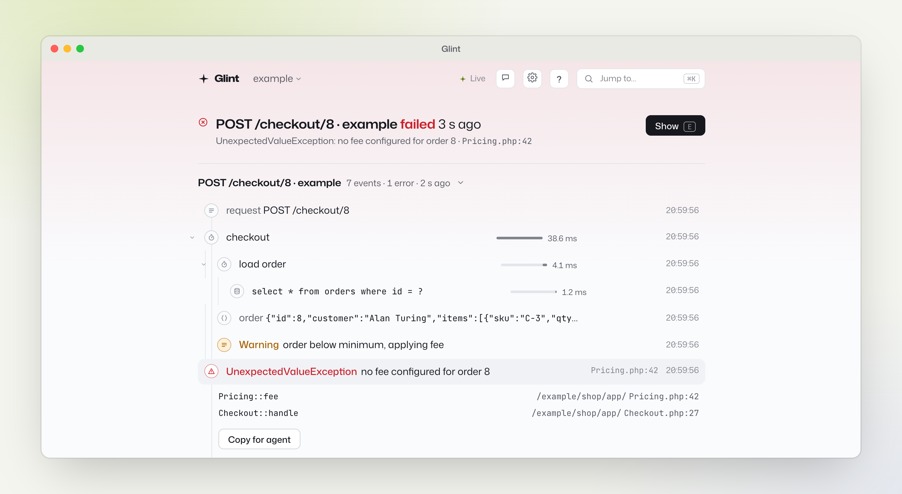
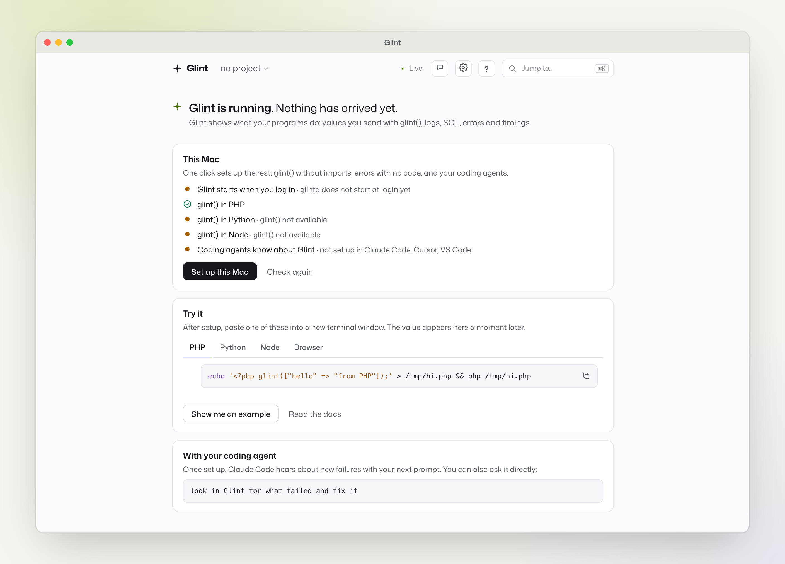
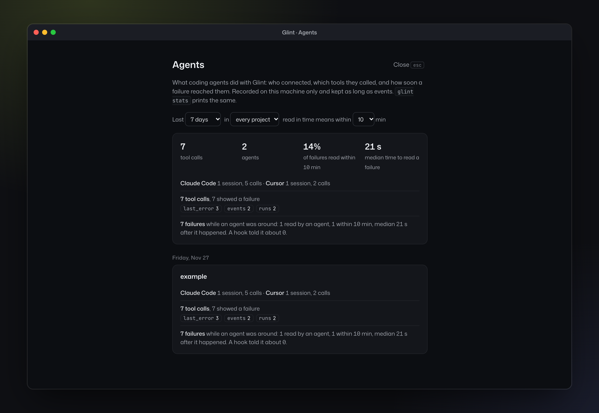
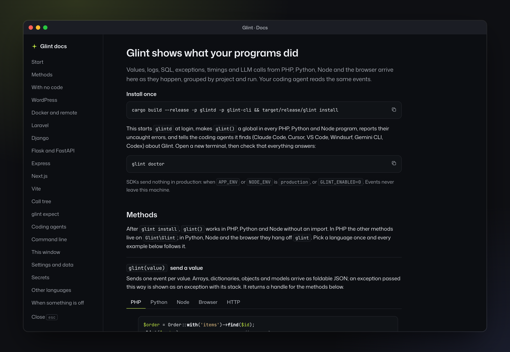

<p align="center">
  <picture>
    <source media="(prefers-color-scheme: dark)" srcset="docs/assets/banner-dark.png">
    
  </picture>
</p>

<p align="center">
  <a href="https://github.com/sodx/glint-releases/releases/latest"></a>
  
  
  
</p>

<p align="center">
  <a href="https://github.com/sodx/glint-releases/releases/latest"><b>Download for Mac</b></a> ·
  <a href="docs/INSTALL.md">Install guide</a> (<a href="docs/INSTALL.ru.md">по-русски</a>) ·
  <a href="#coding-agents">Coding agents</a> ·
  <a href="docs/ARCHITECTURE.md">How it works</a>
</p>

Glint is a local debugging desk for developers and their coding agents. Programs in any language
send it values, logs, SQL queries, exceptions, timings and LLM calls. You watch them arrive in a
live, searchable window, and your agent reads the same events over MCP instead of guessing what the
program did.

<picture>
  <source media="(prefers-color-scheme: dark)" srcset="docs/assets/run-dark.png">
  
</picture>

```php
glint($order)->label('before save')->orange();
```
```python
answer = glint.pause("check the discount before charging")   # waits until you press Continue
```
```bash
npm run dev 2>&1 | glint pipe --label web   # output still prints; Glint picks up levels, JSON logs and stack traces
glint send '{"user":{"id":7}}' --label checkout
```

Any language can send events with a JSON POST. Glint also accepts what programs already emit:
OpenTelemetry, Ray's protocol, piped output and log lines. Everything stays on your machine, in one
SQLite file behind a daemon that listens on loopback only.

## Install

### The Mac app

Download `Glint-<version>-macos-arm64.dmg` from the
[latest release](https://github.com/sodx/glint-releases/releases/latest), drag Glint into
Applications and open it. The window lists what is set up on this Mac, and **Set up this Mac** does
the rest in a few seconds. [docs/INSTALL.md](docs/INSTALL.md) walks through it, including the one
macOS prompt you see the first time (in Russian: [docs/INSTALL.ru.md](docs/INSTALL.ru.md)).



The app lives in the menu bar. The spark turns red when something fails and amber when a program
waits for you, a notification says which, and ⌥⌘G opens the window from anywhere. Glint updates
itself: when a new version is out, the menu shows **Update to x.y.z…** and one click installs it
with glintd and the `glint` command.

### From source

You need Rust 1.88 or newer. The zero-setup `glint()` works with PHP 8.0+, Python 3.9+ and Node 18+
(the `php`, `python3` and `node` on your PATH). glintd and the CLI run on macOS and Linux; the
desktop app is macOS only for now.

```bash
cargo build --release -p glintd -p glint-cli && target/release/glint install
glint doctor      # is glintd up, does glint() work in each language, which agents know about Glint
glint uninstall   # removes what install wrote and keeps your data in ~/.glint
```

`glint install` starts glintd at login (launchd or systemd) and makes `glint()` a global in every
PHP, Python and Node program on the machine, with no package, import or configuration. It also
reports their uncaught errors. SDKs send nothing when `NODE_ENV` or `APP_ENV` is `production`.

PHP gets the global through `auto_prepend_file` (an existing prepend file keeps working), Python
through a `.pth` file in the user site-packages, and Node through `NODE_OPTIONS=--import` in your
shell profile. A project that vendors its own copy of the SDK uses that copy. `--only php,node`
and `--dry-run` narrow the install down.

PHP skips the prepend file for a `php -S` router script (`php -S host:port router.php`). Serve a
document root instead (`php -S host:port -t public`), or require the SDK in that project.

To try it without installing:

```bash
cargo run -p glintd                       # the window at http://127.0.0.1:23600
cargo run -q -p glint-cli -- send 42 hello
```

## Coding agents

`glint install` registers Glint's MCP server with the agents it finds, by their settings folder,
their app or their command. Claude Code gets it at user scope, so every project sees it, plus hooks
that put its own session next to your program's events. Cursor, VS Code, Windsurf and Gemini CLI
get the server over HTTP, and Codex over stdio. Existing settings are kept, each edited file gets a
one-time `.glint-backup` copy, and `glint uninstall` removes exactly what was added. An agent loads
Glint when a session starts, so start a new one after setup.

The hooks also let Glint talk to Claude Code. At the start of a session it learns that Glint
records the project. With each of your prompts it gets the failures that happened since the
previous one, so when you write "it's broken" it already has the error and the line. When it wants
to finish a turn during which your programs failed, it is sent back once to fix them or say why they
are expected. Both behaviours can be turned off in Settings.



The Agents view (`g`) shows what agents did with Glint: which ones connected, which tools they
called, how many failures they read and how soon after the failure happened. Inside a run, events
an agent read carry a "read by" mark. `glint stats` prints the same numbers. All of it is recorded
on this machine and kept as long as events. `examples/agent-eval/` is an opt-in experiment that
runs seeded bugs with and without Glint, to measure whether it helps; it costs model usage, so it
never runs in tests.

To connect an agent by hand:

```bash
claude mcp add --transport http glint http://127.0.0.1:23600/mcp   # or: claude mcp add glint -- glint mcp
glint hook --print-config                                          # Claude Code hooks for .claude/settings.json
```

## Errors with no code

The global install chains each language's own handlers, so uncaught errors of PHP, Python and
Node processes reach Glint while output and exit codes stay as they were. A web front end in
development gets the same with one tag, which also reports `console.error`, failed requests and
markers sent with `window.glint()`:

```html
<script src="http://127.0.0.1:23600/v1/browser.js" data-project="shop"></script>
```

## Frameworks

Laravel, Django, Flask, FastAPI, Express, Next.js and WordPress need no package, middleware or
settings: the global install hooks into them when they load. Each request becomes a run with one
summary at its root (method, route, controller or view, status, time, memory, number of queries),
and under it every SQL query with the line in your code that ran it, the framework's exceptions
with their request, log records, and outgoing HTTP calls that failed.

| Framework | Hooked through | SQL from |
| --- | --- | --- |
| Laravel (also `artisan serve` and queue workers, one run per job) | the PHP prepend file, as the app boots | every connection (`DB::listen`) |
| Django | the Python shim, when the request handler loads | every connection (`execute_wrapper`) |
| Flask, FastAPI, Starlette | the Python shim | SQLAlchemy |
| Express, Next.js, any `node:http` server | the Node shim (`NODE_OPTIONS`) | `pg`, `mysql2`, `node:sqlite` |
| WordPress, Gutenberg included | the PHP prepend file, before WordPress loads | `$wpdb`, with the theme or plugin line behind each query |

WordPress also reports database errors, `WP_Error`s, `_doing_it_wrong()` and deprecation notices,
mail sent with `wp_mail()`, HTTP API calls and REST responses with an error status. The browser
script goes into the front end, wp-admin and the login page, and in the block editor invalid blocks
and notices such as "Updating failed" arrive with the reason. `Glint\WordPress` adds `post()`,
`user()`, `query()`, `hooks('save_post')`, `template()`, `conditionals()`, `options()` and
`queries()` for code. A production site is left alone, and `GLINT_WP` chooses what to report.

`sdks/js/src/vite.js` is a Vite plugin that puts the browser script on dev server pages and nothing
in a production build. `examples/frameworks/` holds a small app for each framework, and
`python3 examples/frameworks/check.py` runs the ones whose toolchain is installed against a sandbox
glintd and checks what arrives.

## Docker and remote machines

Code in a container has no global `glint()`, and 127.0.0.1 there is the container itself. Run
`glint docker` in the project folder: it writes a copy of the SDKs to `~/.glint/sdk/container` and
prints what to add to the service in `docker-compose.yml`:

```yaml
    volumes:
      - /Users/me/.glint/sdk/container:/opt/.glint/sdk:ro
    environment:
      GLINT_URL: http://host.docker.internal:23600
      GLINT_PROJECT: shop
      GLINT_PATH_MAP: /var/www/html:/Users/me/shop
      PHP_INI_SCAN_DIR: ":/opt/.glint/sdk/php/conf.d"
    extra_hosts:
      - host.docker.internal:host-gateway
```

Then `glint()` works in PHP, Python and Node in the container, and uncaught errors arrive as they
do on the Mac. `GLINT_PROJECT` names the git repository, which a path like `/var/www/html` does
not tell. `GLINT_PATH_MAP` maps the container folder to this one, so stack frames and Open in
editor point at the files here. `--run` prints `docker run` flags and `--devcontainer` a
devcontainer.json snippet. Inside a container the SDKs try `http://host.docker.internal:23600`
when `GLINT_URL` is not set.

Docker Desktop on a Mac passes `host.docker.internal` to the Mac's 127.0.0.1. On Linux the
container reaches the Docker bridge instead: set `remote_addr = "172.17.0.1:23600"` in
`~/.glint/config.toml` and restart glintd. That listener only takes events; it cannot be used to
read them.

Over SSH, keep glintd on the Mac and open a reverse tunnel, `ssh -R 23600:127.0.0.1:23600 devbox`
(or `RemoteForward 23600 127.0.0.1:23600` in `~/.ssh/config`, which VS Code Remote SSH also
reads). `glint docker --ssh devbox` prints how to copy the SDK there and what to put in the remote
shell profile.

## Call tree, pauses and checks

Wrap a piece of work in `glint.measure("checkout", fn)` and everything `fn` sends nests under it:
values, SQL, logs and inner measures. The window shows the run as a call tree with a small waterfall
of where the time went, as in the picture at the top. OpenTelemetry spans nest the same way.

`glint.pause(reason)` stops the program until someone presses Continue in the window, or an agent
answers through MCP, and returns the value they gave. It works in PHP, Python, Node and the browser.

Markers become tests. `glint expect`, and the MCP tool `glint_expect` for agents, waits until
events match each expectation in order and fails as soon as a program errors:

```bash
glint expect 'label:cart payload.value.total>0' 'kind:sql.query text:"insert into orders"' \
             'label:"order saved" payload.value.paid=true' -- ./scripts/checkout.sh 7
```

All terms of one expectation must hold for the same event: `label:X`, `kind:X` or `kind:sql.*`,
`text:X`, `has:PATH`, `PATH=VALUE` (also `!= > >= < <=`) and `count>=N`. It exits with 0 when
everything matched, 1 when something did not, and 2 when it could not check. Without a command it
also looks at the last 30 seconds and waits while you click through the app.

## Secrets

glintd replaces passwords, tokens and keys in every event before storing it, so they never reach
the database, the window or a coding agent. It catches values under secret-looking keys
(`password`, `api_key`, `authorization`, `cookie`, `*_token`, `dsn`, ...) at any depth, SQL
bindings for such columns, and well-known shapes anywhere in text: Bearer tokens, JWTs, AWS, GitHub,
Slack, Stripe, OpenAI and Anthropic keys, Google API keys, PEM private keys and `user:pass@` in
URLs. Values read `[redacted]`, or keep their prefix (`sk-ant-…[redacted]`), and the event's
`meta.redacted` says how many were replaced. Counters like `token_count` and ids like `session_id`
stay visible.

Settings, under Secrets, adds key names and regular expressions, lists keys never to hide, or
turns it off. In `~/.glint/config.toml` these are `redact`, `redact_keys`, `redact_patterns` and
`redact_allow` (environment: `GLINT_REDACT`, `GLINT_REDACT_KEYS`, ...).

## Data, settings and docs

glintd keeps 7 days and at most 100,000 events by default. Every 10 minutes it deletes older events
and the database file shrinks with them. The Settings view (`,`) changes how long events are kept,
which editor files open in, and whether agents hear about failures. It saves to
`~/.glint/config.toml`, which you can also edit by hand; an environment variable of the same name
wins over both.

When something does not work, **Send diagnostics** in Settings (or `glint report`) writes one file
to your Downloads folder with versions, what setup found, its log and glintd's log. Nothing is
sent anywhere; you pass the file on yourself.



The Docs view (`?`) has an example of every method in every language, a page per framework, and
how to add a language of your own.

## More

Ray client libraries work unchanged, because glintd also listens on Ray's port `23517`.

To trace LLM calls without Glint code, point any OpenTelemetry exporter at Glint. GenAI spans
(from OpenLLMetry, vendor instrumentors, or the GenAI semantic conventions) become LLM calls with the
transcript, tokens and latency:

```bash
OTEL_EXPORTER_OTLP_ENDPOINT=http://127.0.0.1:4318 python app.py
```

## Development

```bash
cargo test --release --workspace                 # unit and integration tests
python3 examples/e2e/run.py                      # a PHP shop, a Python worker and a Node API through the global glint()
python3 examples/frameworks/check.py             # each framework example against a sandbox glintd
scripts/clean-mac-check.sh                       # a new tester on a clean Mac, in a sandbox HOME
app/bundle-macos.sh --install                    # builds Glint.app, with glintd inside, into ~/Applications
```

`app/release.sh` builds, signs and publishes a release that installed apps pick up
([docs/RELEASING.md](docs/RELEASING.md)). `node docs/assets/shoot.mjs` remakes the pictures in this
README from a running glintd.

How it is built: [docs/ARCHITECTURE.md](docs/ARCHITECTURE.md). The wire format and API:
[docs/PROTOCOL.md](docs/PROTOCOL.md). Adding a language: the Docs view, and
[spec/conformance/README.md](spec/conformance/README.md).
