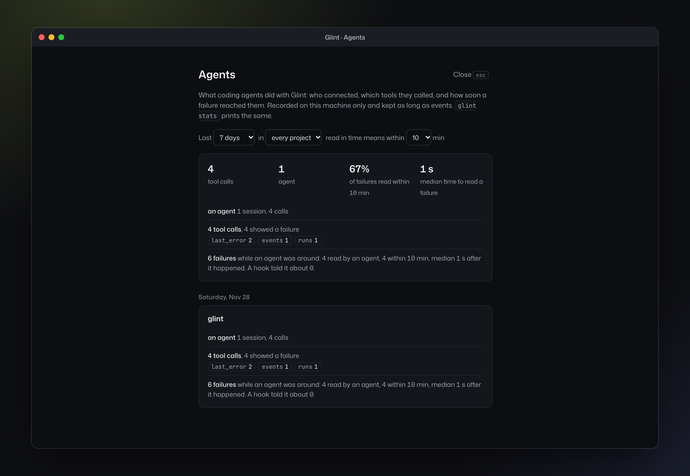

# Coding agents

`glint install` registers Glint's MCP server with the agents it finds, by their settings folder,
their app or their command. Claude Code gets it at user scope, so every project sees it, plus hooks
that put its own session next to your program's events. Cursor, VS Code, Windsurf and Gemini CLI
get the server over HTTP, and Codex over stdio. Existing settings are kept, each edited file gets a
one-time `.glint-backup` copy, and `glint uninstall` removes exactly what was added. An agent loads
Glint when a session starts, so start a new one after setup.

The hooks also let Glint talk to Claude Code. At the start of a session it learns that Glint
records the project. With each of your prompts it gets the failures that happened since the
previous one, so when you write "it's broken" it already has the error and the line. When it wants
to finish a turn during which your programs failed, it is sent back once to fix them or say why they
are expected. Both behaviours can be turned off in Settings.



The Agents view (`g`) shows what agents did with Glint: which ones connected, which tools they
called, how many failures they read and how soon after the failure happened. Inside a run, events
an agent read carry a "read by" mark. `glint stats` prints the same numbers. All of it is recorded
on this machine and kept as long as events. `examples/agent-eval/` is an opt-in experiment that
runs seeded bugs with and without Glint, to measure whether it helps; it costs model usage, so it
never runs in tests.

To connect an agent by hand:

```bash
claude mcp add --transport http glint http://127.0.0.1:23600/mcp   # or: claude mcp add glint -- glint mcp
glint hook --print-config                                          # Claude Code hooks for .claude/settings.json
```

[Back to the README](../README.md)
