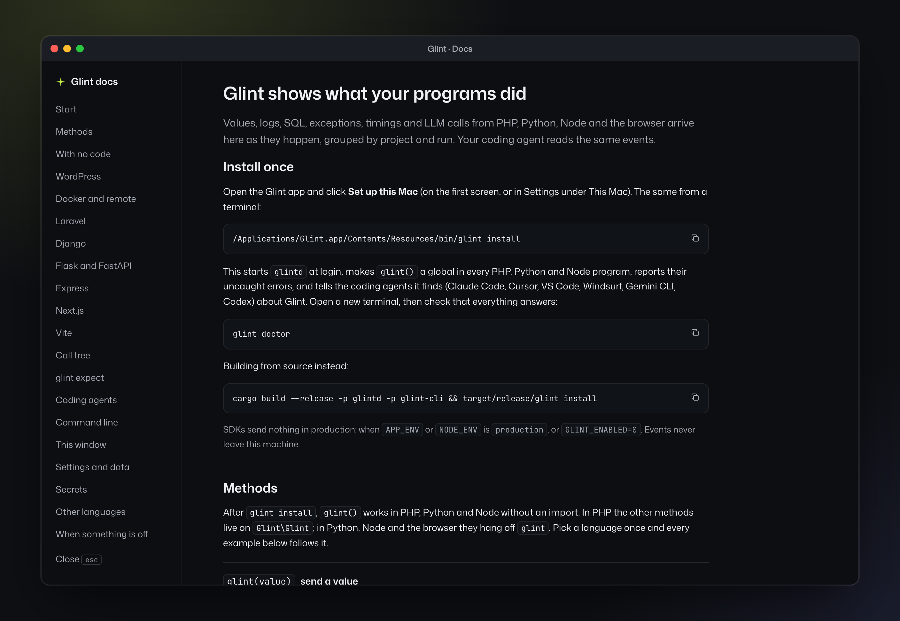

# Data, settings and other inputs

glintd keeps 7 days and at most 100,000 events by default. Every 10 minutes it deletes older events
and the database file shrinks with them. The database also stays under 500 MB (`max_db_bytes`,
`GLINT_MAX_DB_BYTES`, units such as `2GB` work); glintd checks that every 10 seconds and deletes the
oldest events when it is crossed. One event takes at most 1 MB: larger ones (from OpenTelemetry or
agent hooks) are stored with their longest strings cut and marked `meta.truncated`. The Settings view (`,`) changes how long events are kept,
which editor files open in, and whether agents hear about failures. It saves to
`~/.glint/config.toml`, which you can also edit by hand; an environment variable of the same name
wins over both.

When something does not work, **Save diagnostics report** in Settings (or `glint report`) writes one file
to your Downloads folder with versions, what setup found, its log and glintd's log. Nothing is
sent anywhere; you pass the file on yourself.



The Docs view (`?`) has an example of every method in every language, a page per framework, and
how to add a language of your own.

## OpenTelemetry

To trace LLM calls without Glint code, point any OpenTelemetry exporter at Glint. GenAI spans
(from OpenLLMetry, vendor instrumentors, or the GenAI semantic conventions) become LLM calls with the
transcript, tokens and latency:

```bash
OTEL_EXPORTER_OTLP_ENDPOINT=http://127.0.0.1:4318 python app.py
```

[Back to the README](../README.md)
